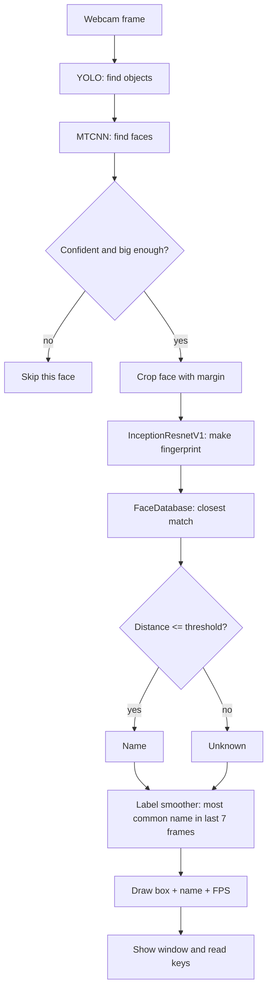

# Face Recognition Upgrade

> [!summary] What this does
> The app used to only **find** faces. Now it also **knows whose face** it is.
> You can teach it new people from the webcam, it remembers them after a restart,
> and you can delete people.

---

## 1. The big idea: two questions, two models

Every frame needs two answers:

| Question | Model | Output |
|---|---|---|
| Where is a face? | MTCNN (`facenet_pytorch`) | A box and a confidence score |
| Who is it? | InceptionResnetV1 (`facenet_pytorch`) | A **fingerprint**: 512 numbers |

> [!tip] Analogy
> Think of a fingerprint for a face. Two photos of the same person give
> fingerprints that are close together. Two different people give fingerprints
> that are far apart. We never compare pictures directly, only these number lists.

YOLO is a third, separate model. It finds general objects like cups and phones.

---

## 2. How one frame flows through the code

---

## 3. The files and what each one does

### `config.py`: the control panel
All the numbers live here: camera size, thresholds, file paths. Change a number
here instead of searching through code. See [[#5. Tuning guide]].

### `face_db.py`: the album of known people
- Saves names and fingerprints to `faces/database.json`
- **Averages** several snapshots into one fingerprint per person
- `identify()` finds the closest saved person, or returns `Unknown`

### `main.py`: the program that runs everything
- Loads the three models once, before the camera starts
- Loops over frames, detects, identifies, draws, and reads keys

---

## 4. Key concepts explained

### Fingerprint (embedding)
A list of 512 numbers that describes a face. The numbers are not understandable
to us. They just need to be consistent: the same person gives similar numbers.

### Normalizing (making length 1)
We scale each fingerprint so its length is exactly 1. This makes comparisons fair,
because lighting and brightness changes won't dominate the result.

### Distance
The straight-line distance between two fingerprints, the same idea as the distance
between two points on a map, just in 512 dimensions.
- Small distance = probably the same person
- Large distance = probably different people

### Threshold
The cutoff line. If the closest person is within the threshold, we show their name.
Otherwise we show `Unknown`. This is the most important setting in the project.

### Averaging snapshots
Taking 8 snapshots from different angles and averaging them gives a more reliable
fingerprint than any single photo. One blurry frame can't ruin the result.

### Label smoothing (voting)
Recognition can flicker frame to frame. The app keeps the last 7 answers for each
face and shows the most common one. This is why the name feels stable.

> [!warning] Limitation
> Faces are matched to slots by left-to-right position. If two people swap
> places quickly, their voting history can briefly mix. A real tracker
> (like DeepSORT) fixes this, and it's a good future upgrade.

### Confidence vs. recognition
- **Detection confidence** (`FACE_MIN_CONFIDENCE`) = "is this really a face?"
- **Match distance** (`MATCH_THRESHOLD`) = "is this face the person I know?"

These are different questions. A face can be detected perfectly and still be
unknown.

---

## 5. Tuning guide

Turn on `SHOW_DISTANCE = True` and watch the numbers on screen.

| Problem you see | Likely cause | Change |
|---|---|---|
| Right person shown as `Unknown` | Threshold too strict | Raise `MATCH_THRESHOLD` a little (0.9 to 1.0) |
| Two people get mixed up | Threshold too loose | Lower `MATCH_THRESHOLD` (0.9 to 0.8) |
| Names flicker | Too few voting frames | Raise `VOTE_WINDOW` |
| Lots of tiny false faces | Detector too sensitive | Raise `MIN_FACE_SIZE` or `FACE_MIN_CONFIDENCE` |
| Image still blurry | Camera resolution | Raise `FRAME_WIDTH` and `FRAME_HEIGHT`, check your camera supports it |
| App too slow | Too much work per frame | Lower resolution, or raise `YOLO_CONFIDENCE` |

> [!tip] Good test routine
> Enroll yourself and your brother with 8 snapshots each. Then stand in front of
> the camera for 30 seconds each, turning your head slowly. Note how often each
> person gets the right name. Adjust the threshold, then repeat.

---

## 6. How to use it

1. Run `python main.py` from the project folder.
2. Stand in front of the camera with **one** face visible.
3. Press `c` 8 times, turning your head slightly between presses.
4. Press `n`, then type your name in the terminal and press Enter.
5. Your name now appears on your face. It stays after restarts.
6. To remove someone, press `d` and type their name.
7. Press `q` to quit.

> [!note] Why the window pauses for typing
> `input()` reads from the terminal and blocks the program until you press Enter.
> That is expected. The video window freezes for a moment while you type.

---

## 7. Mistakes the old version had (and how this fixes them)

- **Face boxes were drawn on the wrong image copy.** Now everything is drawn on one `frame`.
- **FPS text was drawn twice.** Now it's drawn once, and the value is smoothed.
- **Blurry image.** The camera is asked for 1280x720.
- **Full-body boxes from YOLO on people.** Person boxes are skipped by default.
- **Only detection, no identity.** Now recognition is added.

---

## 8. Known limits (honest notes)

- Recognition accuracy depends on **lighting, angle, and camera quality**. Enroll in the same
  lighting you'll use the app in.
- Two very similar-looking people may still be confused. Tuning helps, but has limits.
- Only one `Unknown`/name decision per face per frame. No "remember when last seen" yet.
- Enrolling the same name again **replaces** the old fingerprint.

---

## 9. Next steps (ideas for later)

- [ ] Add a real tracker (DeepSORT) so identities stick to people while they move
- [ ] "Last seen" memory: store a timestamp each time someone is recognized
- [ ] Liveness check so a photo of a person can't fool the system
- [ ] Move the database to SQLite (ties in with [[face-attendance-system]])
- [ ] Voice commands from the microphone (planned for the smart-glasses goal)

---

## 10. Glossary

- **MTCNN**: a model that finds faces and draws boxes around them
- **Embedding / fingerprint**: a list of numbers that describes a face
- **Threshold**: the cutoff distance for a match
- **Tensor**: a PyTorch array of numbers
- **HWC / CHW**: the order of dimensions in an image array (height-width-color vs color-height-width)
- **BGR / RGB**: the color order. OpenCV uses BGR, most models expect RGB
- **Inference**: using a trained model to make predictions, without learning
- **FPS**: frames per second, how smooth the video feels

---

*Related: [[ai-environment-analyser]] · [[face-attendance-system]]*
