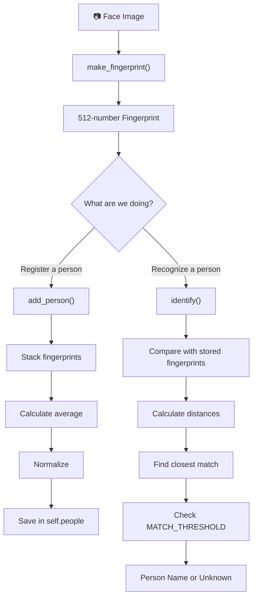
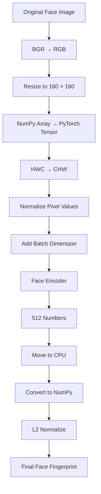
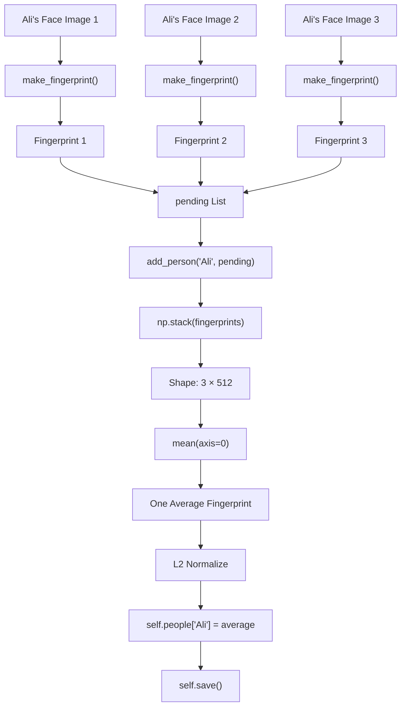
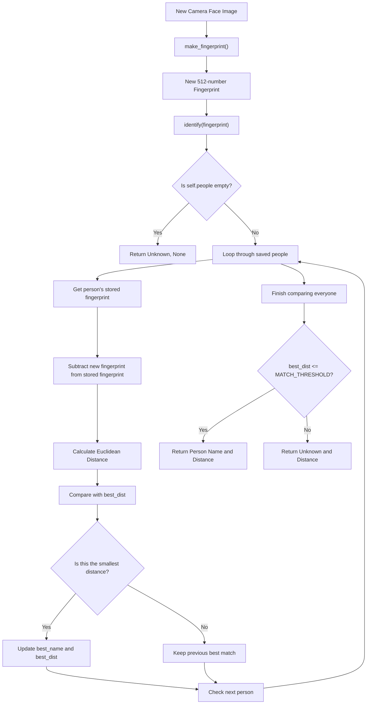

# Future Vision — Visual Workflow of Face Recognition

## 1. Complete System Overview



---

## 2. Function 1 — make_fingerprint()

**Purpose:** Convert one face image into a 512-number fingerprint.



**Input:** One face image.

**Output:** One normalized fingerprint containing 512 numbers.

---

## 3. Function 2 — add_person()

**Purpose:** Combine multiple fingerprints of the same person into one representative fingerprint and save it.

### Registration workflow



### Data transformation

```text
Three fingerprints:

Fingerprint 1 → 512 numbers
Fingerprint 2 → 512 numbers
Fingerprint 3 → 512 numbers
             |
             ↓
         np.stack()
             |
             ↓
         (3, 512)
             |
             ↓
       mean(axis=0)
             |
             ↓
         (512,)
             |
             ↓
       L2 Normalize
             |
             ↓
    Save Ali's fingerprint
```

**Input:** Person's name and multiple fingerprints.

**Output:** One saved representative fingerprint.

---

## 4. Function 3 — identify()

**Purpose:** Compare a new fingerprint with all saved fingerprints and find the closest person.

### Recognition workflow



### What is being compared?

```text
                 NEW FINGERPRINT
                     512 numbers
                         |
          ┌──────────────┼──────────────┐
          ↓              ↓              ↓
       Ali's           Ahmed's         Sara's
      Stored           Stored          Stored
    Fingerprint      Fingerprint     Fingerprint
          |              |              |
          ↓              ↓              ↓
       Distance       Distance       Distance
          |              |              |
          └──────────────┼──────────────┘
                         ↓
                Find Smallest Distance
                         |
                         ↓
                 Check Threshold
                         |
                         ↓
                 Name or Unknown
```

**Input:** One new fingerprint.

**Output:** Closest person's name and distance, or Unknown.

---

## 5. How All Three Functions Work Together

### A. Registration

```text
          CAPTURE ALI'S PHOTOS
             │    │    │
             ↓    ↓    ↓
          make_fingerprint()
             │    │    │
             ↓    ↓    ↓
          FP1   FP2   FP3
             \    |    /
              \   |   /
               ↓  ↓  ↓
             add_person()
                   |
                   ↓
             STACK FINGERPRINTS
                   |
                   ↓
                AVERAGE
                   |
                   ↓
               NORMALIZE
                   |
                   ↓
             SAVE IN DATABASE
```

### B. Recognition

```text
          NEW CAMERA IMAGE
                  |
                  ↓
          make_fingerprint()
                  |
                  ↓
          NEW FINGERPRINT
                  |
                  ↓
              identify()
                  |
                  ↓
        COMPARE WITH DATABASE
                  |
                  ↓
           FIND CLOSEST MATCH
                  |
                  ↓
          CHECK MATCH THRESHOLD
                  |
                  ↓
             NAME / UNKNOWN
```

---

## 6. Remember the Three Responsibilities

| Function | Responsibility |
|---|---|
| `make_fingerprint()` | Creates a fingerprint |
| `add_person()` | Creates and saves a representative fingerprint |
| `identify()` | Finds the closest saved fingerprint |

**The central relationship:**

`make_fingerprint()` creates the numerical representation. Both `add_person()` and `identify()` use that representation for two different purposes: registration and recognition.